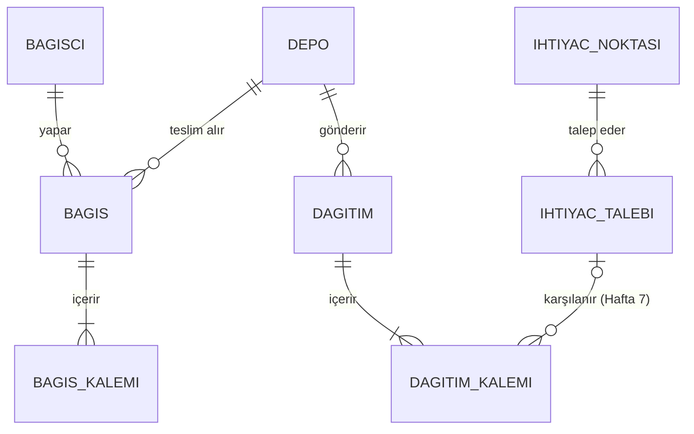

# Bağış Girişi ve İhtiyaç Eşleştirme — Kısa Açıklama (Hafta 7, Çekirdek Modül B)

Bağışları kaydeden ve stoktaki malzemeyi ihtiyaç noktalarının talepleriyle eşleştiren modül. 6. haftanın Envanter modülüyle **entegre** çalışır: bağış stoğa Envanter'in giriş yolundan girer, dağıtım çıkış yolundan çıkar.

| Katman | Dosya | Depo |
|---|---|---|
| Şema | `backend/data/migrations/005_eslestirme.sql` (dağıtım kalemi → talep bağı) | backend |
| Veri erişim | `BagisRepository.liste`, `IhtiyacTalebiRepository.durum_listesi / karsilanan`, `DagitimKalemiRepository.rezerve`, `DagitimRepository.liste` | backend |
| İş kuralları | `BagisServisi` (B1–B8), `EslestirmeServisi` (E1–E9) | backend |
| Testler | `tests/test_bagis_eslestirme.py` (26 test) | backend |
| Arayüz | `frontend/bagis_sayfasi.py`, `frontend/ihtiyac_sayfasi.py`, `frontend/ortak.py` | [frontend](https://github.com/katkat12ihsan/Afet-Yardim-Malzemesi-Lojistik-ve-Dagitim---frontend) |

## Veri modeli



Tablolar 4. haftadan beri vardı. Bu hafta yalnızca **`dagitim_kalemi.ihtiyac_talebi_id`** eklendi: her dağıtım kalemi hangi talebi karşıladığını biliyor. Bu bağ sayesinde aşağıdaki değerler hesaplanabiliyor:

| Kavram | Tanım |
|---|---|
| **karşılanan** | İptal edilmemiş dağıtımlarda bu talebe bağlı kalemlerin toplamı |
| **kalan** | talep miktarı − karşılanan |
| **rezerve** | Bir depodan planlanmış ama henüz yola çıkmamış miktar |
| **uygun stok** | depodaki stok − rezerve (aynı malzeme iki talebe birden verilmesin) |

**Talep durumu artık elle seçilmiyor, hesaplanıyor:** karşılanan 0 ise *Bekliyor*, kısmi ise *Kısmen karşılandı*, tamamı ise *Karşılandı*. 005 migration'ı mevcut dağıtımları taleplerine bağlayıp durumları yeniden hesaplar.

## Bağış Girişi — iş kuralları

| Kod | Kural | Neden |
|---|---|---|
| B1 | En az 1, en fazla 50 kalem | Boş bağış anlamsız |
| B2 | Miktar Envanter kurallarına uyar (K2, K3) | Aynı kural iki yerde farklı olmasın |
| B3 | Aynı malzeme aynı son kullanma tarihiyle iki kez yazılamaz | Yazım hatası ve çifte sayım |
| B4 | Son kullanma tarihi geçmiş ürün kabul edilmez; **gıdada son kullanma tarihi zorunlu** | Afet bölgesine bozuk gıda gitmesin |
| B5 | Depo görevlisi yalnızca kendi deposuna bağış girer (K5) | Sahiplik |
| B6 | Bağışçı listeden seçilir ya da eklenir; telefon ve e-posta isteğe bağlı, girilirse biçimi kontrol edilir | KVKK: en az veri |
| B7 | Bağış tarihi gelecekte olamaz | Kayıt güvenilirliği |
| B8 | Bağışçı, bağış, kalemler, stok girişleri ve hareketler **tek transaction** | Bir kalem hatalıysa hiçbir şey yazılmaz |

## İhtiyaç Eşleştirme — nasıl çalışıyor?

1. Talepler ihtiyaç noktasının **önceliğine** göre (Kritik önce), sonra **talep tarihine** göre (eski önce) listelenir.
2. Bir talep seçilince **kalan** miktar için **uygun stoğu** olan depolar ihtiyaç noktasına **en yakın olandan** başlanarak sıralanır. Mesafe koordinatlardan kuş uçuşu km olarak hesaplanır (Haversine). Gerçek yol mesafesi 9. haftada rota API'siyle gelecek.
3. Öneri en yakın depodan başlayarak kalan dolana kadar doldurulur. Adet, koli ve paket birimlerinde miktar tam sayıya yuvarlanır.
4. Kullanıcı önerilen miktarları değiştirebilir ve **Dağıtımı Planla**'ya basar. Her depo için bir dağıtım kaydı (durumu *Planlandı*) ve talebe bağlı bir kalem oluşur.

### Fazla / eksik durumu

| Durum | Ne yapılıyor? |
|---|---|
| **Fazla gönderim** | Engellenir (E2): atamaların toplamı talebin kalanını aşamaz. Aynı malzeme rezerve sayesinde iki talebe birden de verilemez (E3). |
| **Eksik stok** | Öneri uygun stoğun hepsini kullanır ve **karşılanamayan miktarı** kırmızıyla gösterir; talep *Kısmen karşılandı* olur ve açık kalır. Yeni bağış gelince aynı talep tekrar eşleştirilir. |
| **Genel görünüm** | **Stok–Talep Dengesi** sekmesi her malzeme için toplam uygun stok ile açık talep kalanını karşılaştırır: *Eksik / Dengede / Fazla / Talep yok*. En eksik malzeme en üstte; bağış kampanyası buna göre planlanır. |

## Durum güncelleme — dağıtım yaşam döngüsü

```
Planlandı ──Yola Çıkar──▶ Yolda ──Teslim Edildi──▶ Teslim edildi
    │                       │
    └──────İptal Et─────────┴──▶ İptal   (yoldan dönen malzeme depoya iade girer)
```

- **Stok ne zaman düşer?** Malzeme fiziksel olarak depodan çıkınca, yani *Yolda* olduğunda. Envanter'in çıkış yolundan geçtiği için K1 burada da geçerli: stok o sırada azalmışsa "Yetersiz stok" uyarısı çıkar.
- **Durum geçişleri:** Yalnızca yukarıdaki geçişlere izin var (E7). Örneğin *Planlandı → Teslim edildi* atlanamaz; *Teslim edildi* son durumdur.
- **Talep durumu:** Her geçişten sonra talebin durumu yeniden hesaplanır (E8). İptal edilen bir dağıtım talebi yeniden *Bekliyor* ya da *Kısmen karşılandı* yapar.

## Eşleştirme — iş kuralları

| Kod | Kural |
|---|---|
| E1 | Kapalı (Karşılandı/İptal) talebe eşleştirme yapılamaz |
| E2 | Fazla gönderim yok: atamaların toplamı ≤ kalan |
| E3 | Depodan atanan miktar ≤ o deponun uygun stoğu (rezerve düşülmüş) |
| E4 | Miktar Envanter kurallarına uyar |
| E5 | Aynı ihtiyaç noktası aynı malzeme için ikinci açık talep açamaz |
| E6 | Dağıtımı olan talep iptal edilemez; önce dağıtım iptal edilir |
| E7 | Dağıtım durumları yalnızca tanımlı geçişlerle değişir |
| E8 | Talep durumu her değişiklikte dağıtımlardan yeniden hesaplanır |
| E9 | Dağıtım, kalemler, stok hareketi ve talep durumu tek transaction |

**Yetki:**
- Bağış Girişi: Yönetici ve Depo (kendi deposu).
- İhtiyaç Eşleştirme ve dağıtım durumu: Yönetici ve Kurum.

## Önceki modüllerle entegrasyon

- **Envanter (Hafta 6):**
  - `EnvanterServisi.stok_hareketi_uygula` artık transaction açmadan da çağrılabiliyor. Bağış ve dağıtım servisleri kendi transaction'larının içinden bu yolu kullanıyor; stoğu kendi SQL'leriyle değiştiren başka bir kod yok.
  - Hareket geçmişinde "Bağış #7 - Anonim Bağışçı 3" ve "Dağıtım #5 -> Karlıova Çadır Kent" gibi açıklamalar görünüyor; şeffaflık raporu (Hafta 11) bu izi kullanacak.
  - Miktar, birim ve depo sahipliği kuralları da Envanter'den alınıyor (`miktari_dogrula`, `depo_sahipligi`).
- **Kimlik/yetki (Hafta 5):** Her metot `modul_erisimi` ile başlıyor; stok hareketlerine işlemi yapan kullanıcı yazılıyor.
- **Veritabanı (Hafta 4):** Var olan bağış, talep ve dağıtım tabloları kullanıldı. Tek değişiklik 005 migration'ı; eski veri silinmedi, bağlandı.
- **Ana panel:** "Bekleyen talep" kartı artık hesaplanan talep durumlarını sayıyor.
