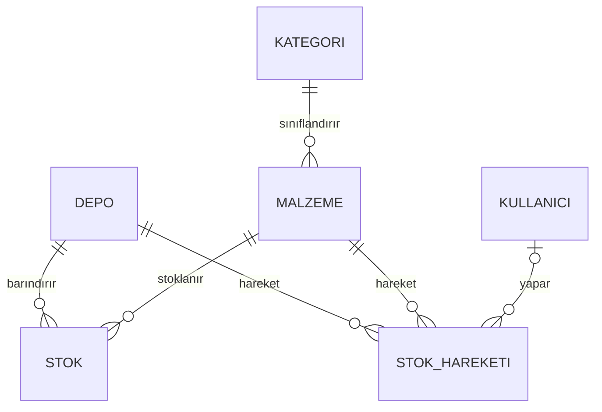

# Envanter Yönetimi — Kısa Açıklama (Hafta 6, Çekirdek Modül A)

Malzeme envanterini yöneten modül: malzeme/kategori tanımları, depoya giriş, depodan çıkış, sayım düzeltmesi, stok seviyesi ve kritik stok uyarısı.

| Katman | Dosya | Depo |
|---|---|---|
| Şema | `backend/data/migrations/003_stok_hareketi.sql` | backend |
| Varlık | `StokHareketi`, `HareketTuru` → `backend/models/entities.py` | backend |
| Veri erişim | `StokHareketiRepository`, `StokRepository.depo_envanteri` → `backend/data/repositories/stok.py` | backend |
| İş kuralları | `EnvanterServisi` → `backend/services/envanter_servisi.py` | backend |
| Testler | `tests/test_envanter.py` (22 test) | backend |
| Arayüz | `frontend/envanter_sayfasi.py` (3 sekme) | [frontend](https://github.com/katkat12ihsan/Afet-Yardim-Malzemesi-Lojistik-ve-Dagitim---frontend) |

## Veri modeli



- **`stok`** (Hafta 4): *Şu an* ne kadar var? Anahtar `(depo_id, malzeme_id)`.
- **`stok_hareketi`** (Hafta 6): *Neden* bu kadar? Her giriş, çıkış ve sayım için silinmeyen bir satır: tür, değişim (+/−), önceki ve sonraki miktar, açıklama, kullanıcı, tarih.
- **Değişmez kural:** Bir depodaki bir malzemenin stoğu, o ikilinin hareketlerinin toplamına eşittir. Hafta 6'dan önce oluşan stoklar için migration bir **Açılış** hareketi yazar; böylece kural eski veride de geçerlidir.

**Veritabanı seviyesindeki kontroller (`003_stok_hareketi.sql`):**
- `sonraki = önceki + değişim` olmalı.
- Giriş pozitif, çıkış negatif olmalı.
- Sonraki miktar eksi olamaz.
- Hareketi yapan kullanıcı silinemez (RESTRICT).

## İş kuralları

| Kod | Kural | Neden |
|---|---|---|
| K1 | Stok eksiye düşemez; çıkış mevcut stoğu aşamaz ("Yetersiz stok…") | Olmayan malzeme dağıtılamaz |
| K2 | adet/koli/paket biriminde miktar tam sayı; kg/litre kesirli olabilir | 2,5 battaniye olmaz, 2,5 kg pirinç olur |
| K3 | Miktar 0'dan büyük, tek harekette en fazla 100.000; "12,5" gibi virgüllü giriş kabul edilir | Yazım hatasıyla dev rakam girilmesin; Türkçe klavye |
| K4 | Sayım düzeltmesinde açıklama zorunlu | Fark (kayıp, hasar, sayım hatası) belgelenmeli |
| K5 | Depo görevlisi yalnızca **kendi deposunu** görür/değiştirir | Sahiplik kontrolü (satır düzeyi yetki) |
| K6 | Malzeme/kategori tanımlarını yalnızca **Yönetici** değiştirir | Tüm depolar aynı kataloğu kullansın |
| K7 | Stoğu/geçmişi olan malzemenin birimi değişmez, malzeme silinemez | Eski miktarların anlamı bozulmasın |
| K8 | Stok güncellemesi + hareket kaydı **tek transaction** | İkisi birlikte yazılır ya da hiçbiri |

Ayrıca aynı adlı malzeme/kategori eklenemez. Karşılaştırma Türkçe'ye uygun yapılır: "GIDA" = "Gıda" ve "BATTANİYE" = "Battaniye". Listeler Türkçe alfabe sırasıyla gelir (Ç, İ, Ü doğru yerde).

## Akış: stok çıkışı

```
Arayüz (Stok Çıkışı penceresi)
  └─ EnvanterServisi.stok_cikisi(token, depo, malzeme, "200", "Karlıova sevkiyatı")
       ├─ modul_erisimi(token, "envanter")      oturum + rol (Kurum → YetkisizErisim)
       ├─ _depo_kontrol                          Depo rolü başka depoya → YetkisizErisim   (K5)
       ├─ _miktar("200", malzeme)                sayı mı, > 0, ≤ 100.000, birim tam sayı?  (K2, K3)
       └─ _hareket_yaz  ── with islem(): ──────────────────────────────────────────────  (K8)
             ├─ stok oku → önceki = 280
             ├─ sonraki = 80; < 0 ise DogrulamaHatasi ("Yetersiz stok")                 (K1)
             ├─ stok.miktar = 80 → kaydet
             └─ stok_hareketi ekle (Çıkış, −200, 280 → 80, depo1, açıklama)
```

Hata olursa arayüz pencereyi kapatmaz ve servisin mesajını kırmızı gösterir; kullanıcı düzeltip tekrar dener.

## Önceki modüllerle entegrasyon

- **Hafta 4 (veritabanı):** Var olan `stok`, `malzeme` ve `kategori` tabloları kullanıldı. Yeni tablo 003 numaralı migration ile eklendi; eski veri silinmedi.
- **Hafta 5 (kimlik/yetki):** Her metot `modul_erisimi(token, "envanter")` ile başlıyor. Rol tablosunda envanter Yönetici ve Depo'ya açık. `kullanici.depo_id` sahiplik kontrolünde kullanılıyor. Hareketlerde işlemi yapan kullanıcı kaydediliyor.
- **Ana panel:** "Kritik stok" kartı Depo görevlisi için yalnızca kendi deposunu sayıyor.
- **Hafta 7 için hazırlık:** Bağış girişi aynı `_hareket_yaz` yolunu ("Giriş") kullanacak; dağıtım da "Çıkış" yolunu. Böylece stok her kaynaktan aynı kurallarla değişecek.
