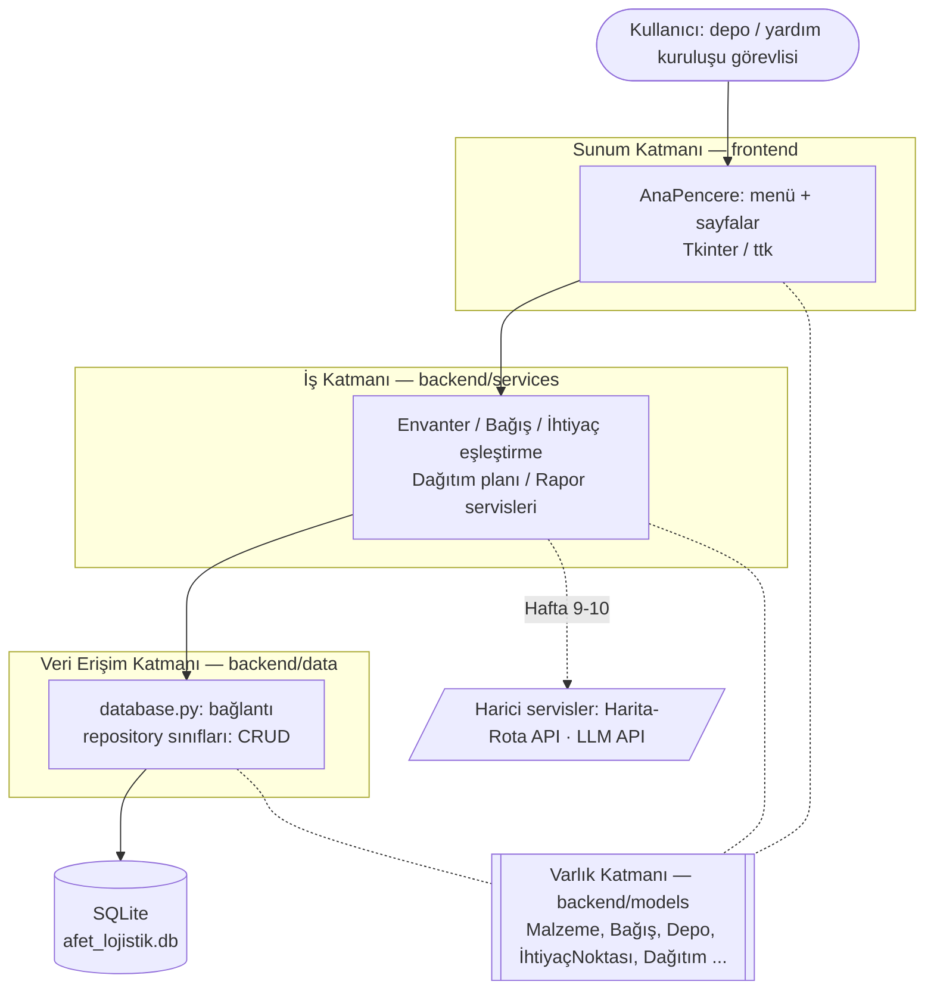
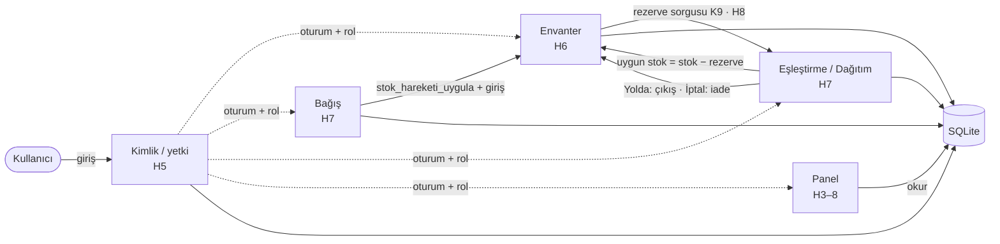

# Mimari Şema — P16 Afet Yardım Malzemesi Lojistik ve Dağıtım

**Uygulama türü:** Python masaüstü uygulaması
**Teknoloji yığını:** Python 3.12 · Tkinter/ttk (arayüz) · SQLite (`sqlite3`, veritabanı) · unittest (test)

## Katmanlı mimari (3 katman + ortak varlık katmanı)



Görsel sürüm: [mimari-sema.svg](mimari-sema.svg)

## Katmanların görevleri

| Katman | Klasör | Görev | Yapmaması gereken |
|---|---|---|---|
| Sunum | `frontend` | Pencereler, formlar, tablolar; kullanıcı girdisini alıp iş katmanına iletmek | SQL yazmak, iş kuralı uygulamak |
| İş | `backend/services` | Doğrulama, stok yeterli mi?, ihtiyaç–stok eşleştirme, öncelik/rota önerisi | Tkinter'a bağımlı olmak |
| Veri erişim | `backend/data` | Veritabanı bağlantısı, CRUD sorguları | İş kararı vermek |
| Varlık | `backend/models` | ER diyagramındaki tabloların Python karşılığı (dataclass) | Başka katmana bağımlı olmak |

**Frontend / backend ayrımı:** Sunum katmanı `frontend/` klasöründe; iş, veri erişim ve varlık katmanları `backend/` klasöründe. Frontend yalnızca backend'in servislerini çağırır, backend frontend'i hiç tanımaz.

**Bağımlılık yönü tek yönlüdür:** Sunum → İş → Veri. Alt katman üst katmanı tanımaz. Bu sayede ör. arayüz Tkinter'dan başka bir kütüphaneye geçse iş ve veri katmanı değişmez; iş kuralları arayüz açılmadan `unittest` ile test edilebilir.

## Depo ve klasör yapısı

Proje iki ayrı GitHub deposundan oluşur. Ayrım, katmanların bağımlılık yönüyle aynıdır: frontend backend'e bağımlıdır, backend frontend'i tanımaz.

| Depo | İçerik | Bağımlılık |
|---|---|---|
| [Backend](https://github.com/katkat12ihsan/Afet-Yardim-Malzemesi-Lojistik-ve-Dagitim---backend) | Varlık, iş ve veri erişim katmanları; şema; testler; dokümantasyon | Yalnızca Python standart kütüphanesi |
| [Frontend](https://github.com/katkat12ihsan/Afet-Yardim-Malzemesi-Lojistik-ve-Dagitim---frontend) | Tkinter arayüzü ve başlangıç noktası | Backend paketi (`requirements.txt` → GitHub) |

```
Afet-Yardim-Malzemesi-Lojistik-ve-Dagitim---backend/
├── pyproject.toml           # Paket tanımı: frontend bunu pip ile kurar
├── backend/                 # BACKEND: arayüzden bağımsız çekirdek
│   ├── config.py            # Ayarlar; gizli anahtarlar ortam değişkeninden
│   ├── guvenlik.py          # Parola hash, token
│   ├── models/entities.py   # Varlık katmanı (ER → dataclass)
│   ├── services/            # İş katmanı
│   └── data/                # Veri erişim katmanı (SQLite, migration'lar, repository'ler)
├── tests/                   # Birim testleri (unittest)
└── docs/                    # ER, mimari, haftalık raporlar, formlar, AI günlüğü

Afet-Yardim-Malzemesi-Lojistik-ve-Dagitim---frontend/
├── main.py                  # Başlangıç noktası (python main.py)
├── frontend/                # FRONTEND: masaüstü arayüz
│   ├── giris_penceresi.py   # Giriş / kayıt
│   ├── main_window.py       # Ana pencere, rol bazlı menü (Tkinter)
│   └── *_sayfasi.py         # Envanter, Bağış, İhtiyaç/Dağıtım, Kullanıcılar sayfaları
├── demo.bat                 # Vize demosu: ayrı demo veritabanı, temiz örnek veri
└── requirements.txt         # afet-lojistik-backend @ git+...backend.git@v0.6.0
```

> Hafta 3–5 boyunca proje tek depoda geliştirildi ([eski tek depo](https://github.com/katkat12ihsan/Afet-Yardim-Malzemesi-Lojistik-ve-Dagitim)); Hafta 6 öncesinde commit geçmişi korunarak iki depoya ayrıldı.

## Neden bu teknolojiler?

- **Python + Tkinter:** Python ile birlikte gelir, ek kurulum gerektirmez; kurumların depo bilgisayarlarında internet olmadan da çalışan bir masaüstü uygulaması hedefleniyor (afet bölgesinde bağlantı kesintisi gerçek bir risk).
- **SQLite:** Sunucu kurulumu gerektirmeyen, tek dosyalık, ilişkisel (yabancı anahtar ve transaction destekli) veritabanı. Tek depo/kurum ölçeği için yeterli; ileride PostgreSQL'e geçilirse yalnızca veri erişim katmanı değişir.
- **Katmanlı mimari:** Modüller (envanter, bağış, eşleştirme, dağıtım, takip, rapor) haftalık olarak eklenecek; her modül aynı üç katmanı izlediği için kod düzenli ve açıklanabilir kalır.

## Modüller ve veri akışı (Hafta 8 · ara sürüm `v0.6.0`)

Vize haftasında modüller uçtan uca birleştirildi. Her modül kendi servis sınıfıdır ve başka bir modülün verisine **SQL ile değil, o modülün servis metodu ile** erişir. Tablolar paylaşılır ama bir tabloyu yalnızca sahibi olan modül değiştirir.

| Modül (hafta) | Servis | Sahip olduğu (yazdığı) veri | Okuduğu veri / kullandığı modül |
|---|---|---|---|
| Kimlik ve yetki (5) | `KimlikServisi`, `yetki.py` | kullanici, oturum, rol_degisikligi | — (diğer tüm servisler buna sorar) |
| Envanter (6) | `EnvanterServisi` | malzeme, kategori, **stok, stok_hareketi** | Kimlik (oturum, rol, depo sahipliği); dağıtım kalemleri (rezerve, K9) |
| Bağış (7) | `BagisServisi` | bagisci, bagis, bagis_kalemi | Envanter (`stok_hareketi_uygula`, `miktari_dogrula`, `depo_sahipligi`) |
| Eşleştirme ve dağıtım (7) | `EslestirmeServisi` | ihtiyac_talebi, dagitim, dagitim_kalemi | Envanter (stok, çıkış/iade yolu); depo ve ihtiyaç noktası koordinatları |
| Panel (3–8) | `OzetServisi`, `modul_servisi` | — (yalnızca okur) | talep durumları, kritik stok, modül durumu |



**Bir isteğin yolculuğu (örnek: dağıtımı "Yolda" yap):**

1. `ihtiyac_sayfasi.py`: kullanıcı **Yola Çıkar**'a basar → `EslestirmeServisi.dagitim_durumu_degistir(token, id, YOLDA)`.
2. Servis `modul_erisimi(token, "dagitim")` ile oturumu ve rolü doğrular (Kimlik).
3. `with islem(baglanti):` transaction açılır. Durum geçişi kontrol edilir (E7). Her kalem için `EnvanterServisi.stok_hareketi_uygula(..., Çıkış)` çağrılır. Envanter stok eksiye düşmesin kuralını (K1) uygular ve hareket kaydı yazar.
4. Herhangi bir kalemde stok yetmezse istisna fırlar, transaction geri alınır: durum da stok da değişmez (`test_yola_cikista_stok_yetmezse_hicbir_sey_degismez`).
5. Başarılıysa talep durumu yeniden hesaplanır; arayüz tabloyu yeniler, panel sayısı değişir.

**Entegrasyon testi yaklaşımı:** Birim testleri bir servisi tek başına dener. `tests/test_entegrasyon.py` ise uygulamanın `main.py`'de kurduğu servis zincirinin aynısını bellek içi veritabanıyla kurar ve senaryoyu baştan sona çalıştırır. Frontend deposundaki `tests/test_arayuz.py` her rolle her sayfayı ve sekmeyi gerçekten açar. Hafta 8'de bulunan iki hata için birer **regresyon testi** yazıldı; hata geri gelirse test kırmızı olur.
